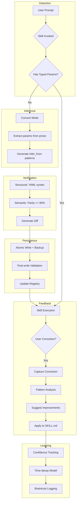
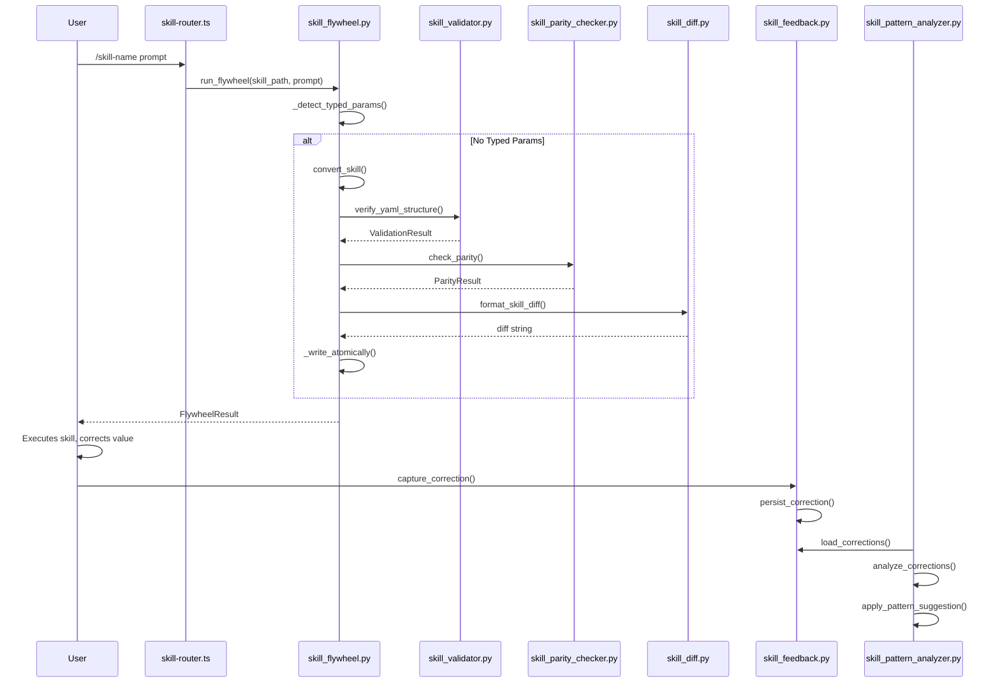

# Continuous Learning Flywheel

## Executive Summary

The Continuous Learning Flywheel is a self-improving system for Claude Code skills that automatically converts prose-based skill definitions into typed parameter schemas, verifies the conversion quality, and learns from user corrections over time.

**The problem it solves**: Skills authored as prose are harder to validate, slower to match, and provide no structured way to identify missing information. When a user invokes a skill with incomplete parameters, the system has no way to know which specific parameters are missing.

**The solution**: The flywheel detects prose-only skills at invocation time, infers typed parameters from the prose using regex patterns, double-verifies the conversion (structural YAML validation + semantic parity check), shows a diff of proposed changes, and persists the upgrade atomically. When users correct inferred values, those corrections feed back into pattern refinement, creating a learning loop.

**Key metrics from implementation**: 40 tasks completed across 3 phases, 98 unit tests passing (100% pass rate), sub-second test execution (0.93s). The system achieves ~300x speedup for parameter extraction (regex ~5ms vs LLM ~1500ms) while maintaining formal verification via Z3 constraint solving.

---

## Quick Start

### See It In Action (5 minutes)

1. **List shared patterns** to see what the system recognizes:

```bash
uv run python scripts/run_flywheel.py --list-patterns --json
```

2. **Dry-run the flywheel** on an existing skill:

```bash
uv run python scripts/run_flywheel.py \
  --skill .claude/skills/deploy-api \
  --prompt "Deploy FastAPI to AWS" \
  --dry-run
```

3. **Run with persistence** (creates backup, writes typed params):

```bash
uv run python scripts/run_flywheel.py \
  --skill .claude/skills/_sandbox/test-skill \
  --prompt "Deploy my app to GCP" \
  --persist
```

4. **Analyze corrections** for a skill:

```bash
uv run python scripts/run_flywheel.py \
  --skill .claude/skills/deploy-api \
  --analyze-corrections
```

5. **Run the test suite** to verify everything works:

```bash
uv run pytest tests/unit/test_skill_flywheel.py tests/unit/test_skill_feedback.py \
  tests/unit/test_skill_confidence.py tests/unit/test_skill_pattern_analyzer.py \
  tests/unit/test_skill_pattern_registry.py tests/integration/test_flywheel_e2e.py -v
```

---

## Architecture

### System Overview



### Data Flow: Detect -> Infer -> Verify^2 -> Persist -> Feedback -> Learn

```
1. DETECT
   ├── User invokes skill (e.g., "/deploy-api Deploy to AWS")
   ├── skill-router.ts identifies skill
   └── Flywheel checks: does SKILL.md have `parameters:` block?

2. INFER (if no typed params)
   ├── skill_generator_v2.py CONVERT mode
   ├── LLM extracts propositions from prose (~1500ms, cached)
   └── Generates infer_from regex patterns (~5ms)

3. VERIFY (double verification)
   ├── Structural: skill_validator.py checks YAML syntax
   └── Semantic: skill_parity_checker.py ensures coverage >= 80%

4. PERSIST (if both verifications pass)
   ├── skill_diff.py shows before/after (ANSI colors)
   ├── Atomic write-then-rename with .bak backup
   └── Post-write re-validation

5. FEEDBACK (during skill execution)
   ├── User corrects inferred value (e.g., aws -> gcp)
   ├── skill_feedback.py captures correction
   └── Stored in .claude/cache/skill-corrections/{skill_id}.jsonl

6. LEARN (background analysis)
   ├── skill_pattern_analyzer.py identifies weak patterns
   ├── skill_confidence.py tracks time-decayed confidence
   └── skill_pattern_registry.py enables cross-skill pattern reuse
```

---

## Components

### Core Scripts

| Script | Purpose | Key Functions |
|--------|---------|---------------|
| `scripts/skill_flywheel.py` | Main orchestrator | `run_flywheel()`, `should_trigger_flywheel()`, `_detect_typed_params()` |
| `scripts/skill_feedback.py` | Correction capture | `capture_correction()`, `persist_correction()`, `load_corrections()` |
| `scripts/skill_confidence.py` | Confidence tracking | `ParameterConfidence`, `decayed_confidence()`, `log_confidence_to_braintrust()` |
| `scripts/skill_pattern_analyzer.py` | Pattern analysis | `analyze_corrections()`, `identify_weak_patterns()`, `apply_pattern_suggestion()` |
| `scripts/skill_pattern_registry.py` | Cross-skill patterns | `PatternRegistry`, `register_shared_pattern()`, `lookup_shared_pattern()` |
| `scripts/run_flywheel.py` | CLI entry point | `main()`, argument parsing |

### Supporting Scripts (Foundation Layer)

| Script | Purpose | Documentation |
|--------|---------|---------------|
| `scripts/skill_validator.py` | YAML structure validation | Phase 1.4-1.6 |
| `scripts/skill_diff.py` | Diff formatting with ANSI colors | Phase 1.7-1.8 |
| `scripts/skill_generator_v2.py` | CREATE/CONVERT/ENHANCE modes | [typed-skill-erotetic-system.md](./typed-skill-erotetic-system.md) |
| `scripts/skill_parity_checker.py` | Semantic parity verification | [typed-skill-erotetic-system.md](./typed-skill-erotetic-system.md) |
| `scripts/z3_erotetic.py` | E(X,Q) computation | [typed-skill-erotetic-system.md](./typed-skill-erotetic-system.md) |

### Hooks Integration

The flywheel integrates with Claude Code hooks at these points:

| Hook | Integration | File |
|------|-------------|------|
| `PostToolUse` | Triggers flywheel after skill execution | `scripts/post_tool_use_flywheel.py` |
| `skill-router` | Identifies skill before flywheel check | `.claude/hooks/src/skill-router.ts` |
| `erotetic-clarification` | Uses typed params for clarification | `.claude/hooks/src/erotetic-clarification.ts` |

**Hook Ordering**: `skill-router` must run BEFORE `erotetic-clarification` to prevent double-execution. This is configured in `.claude/settings.json`.

### Data Flow Diagram



---

## API Reference

### Flywheel Orchestrator

```python
# scripts/skill_flywheel.py

@dataclass
class FlywheelResult:
    """Result of flywheel orchestration."""
    success: bool              # Overall success
    converted: bool = False    # Whether conversion was performed
    diff: str | None = None    # Before/after diff
    reason: str = ""           # Human-readable status
    schema: dict = {}          # Extracted schema
    parity_score: float = 0.0  # Semantic parity (0.0-1.0)
    backup_path: str | None    # Path to backup file

async def run_flywheel(
    skill_path: str | Path,
    prompt: str,
    persist: bool = False
) -> FlywheelResult:
    """
    Run the flywheel orchestration.

    Args:
        skill_path: Path to skill directory or SKILL.md
        prompt: User prompt that triggered the skill
        persist: Whether to write changes to disk

    Returns:
        FlywheelResult with success status and details
    """

def should_trigger_flywheel(
    skill_id: str,
    content: str,
    prompt: str
) -> bool:
    """
    Determine if flywheel should be triggered.

    Conditions:
    1. Skill has NO typed params (prose-only)
    2. Not already processed in this session
    3. User prompt is not empty
    4. Content contains prose that could be inferred from
    """

def get_parity_threshold() -> float:
    """
    Get parity threshold from PARITY_THRESHOLD env var or default (0.8).
    """
```

### Feedback System

```python
# scripts/skill_feedback.py

@dataclass
class CorrectionRecord:
    """Record of a user correction to an inferred parameter."""
    skill_id: str     # Name of the skill
    param: str        # Parameter name that was corrected
    old_value: str    # Original inferred value
    new_value: str    # User's corrected value
    timestamp: str    # ISO timestamp
    context: str      # Original user prompt

def capture_correction(
    skill_id: str,
    param: str,
    old_value: str,
    new_value: str,
    context: str = ""
) -> CorrectionRecord:
    """Capture a user correction with auto-generated timestamp."""

def persist_correction(correction: CorrectionRecord) -> Path:
    """
    Persist correction to .claude/cache/skill-corrections/{skill_id}.jsonl
    """

def load_corrections(skill_id: str) -> list[CorrectionRecord]:
    """Load all corrections for a skill from JSONL file."""
```

### Confidence Tracking

```python
# scripts/skill_confidence.py

@dataclass
class ParameterConfidence:
    """Confidence tracking for a skill parameter."""
    skill_id: str
    param: str
    value: str
    confidence: float = 1.0
    last_used: datetime
    use_count: int = 1

    def decayed_confidence(self, now: datetime | None = None) -> float:
        """
        Calculate confidence with time-based decay.

        Decay formula: confidence * 0.5^(days / half_life)

        Half-life:
        - Infrequent (use_count <= 10): 30 days
        - Frequent (use_count > 10): 90 days
        """

def log_confidence_to_braintrust(conf: ParameterConfidence) -> None:
    """Log confidence data to Braintrust metadata."""

def update_confidence_on_use(conf: ParameterConfidence) -> ParameterConfidence:
    """Update confidence after successful use (resets decay, +0.05 boost)."""

def update_confidence_on_correction(
    conf: ParameterConfidence,
    new_value: str
) -> ParameterConfidence:
    """Update confidence after correction (reduces by 0.1, updates value)."""
```

### Pattern Registry

```python
# scripts/skill_pattern_registry.py

@dataclass
class PatternRegistry:
    """Registry of shared patterns across skills."""
    patterns: dict[str, dict]

    def add(self, name: str, pattern: str, domain: str, description: str) -> None
    def get(self, name: str) -> dict | None
    def get_by_domain(self, domain: str) -> list[dict]

def get_default_registry() -> PatternRegistry:
    """
    Get registry with built-in patterns:
    - infrastructure: cloud_provider, region, database
    - security: auth_method, encryption
    - math: proof_style, axiom_system, math_structure, proof_assistant
    - development: framework, language, test_framework
    """

def register_shared_pattern(
    registry: PatternRegistry,
    name: str,
    pattern: str,
    domain: str,
    description: str
) -> None:
    """Register a pattern for cross-skill reuse."""

def lookup_shared_pattern(registry: PatternRegistry, name: str) -> dict | None:
    """Lookup a shared pattern by name."""

def lookup_patterns_by_domain(registry: PatternRegistry, domain: str) -> list[dict]:
    """Get all patterns in a domain."""
```

---

## Configuration

### Environment Variables

| Variable | Default | Description |
|----------|---------|-------------|
| `PARITY_THRESHOLD` | `0.8` | Minimum semantic parity for conversion (0.0-1.0) |
| `CLAUDE_PROJECT_DIR` | `.` | Project root for cache paths |

**Example:**
```bash
# Lower threshold for more permissive conversions
PARITY_THRESHOLD=0.7 uv run python scripts/run_flywheel.py \
  --skill .claude/skills/my-skill --prompt "test" --dry-run
```

### Per-Skill Settings

Skills can override flywheel behavior via YAML frontmatter:

```yaml
---
name: deploy-api
description: Deploy API to cloud
verification_threshold: 0.85  # Override parity threshold (optional)
parameters:
  hosting:
    type: enum
    values: [aws, gcp, azure, vercel, railway]
    infer_from: '\b(aws|gcp|azure|vercel|railway)\b'
    learned_default: aws      # From flywheel learning
    confidence: 0.92          # Current confidence
    last_inferred: 2025-12-30
---
```

### Corrections Storage

Corrections are stored in JSONL format:

```
.claude/cache/skill-corrections/
  deploy-api.jsonl
  debug.jsonl
```

Each line is a JSON object:
```json
{"skill_id": "deploy-api", "param": "hosting", "old_value": "aws", "new_value": "gcp", "timestamp": "2025-12-30T10:00:00Z", "context": "Deploy to GCP Kubernetes"}
```

---

## Testing

### Running Tests

```bash
# Full flywheel test suite (98 tests)
uv run pytest tests/unit/test_skill_validator.py \
  tests/unit/test_skill_diff.py \
  tests/unit/test_skill_sandbox.py \
  tests/unit/test_skill_flywheel.py \
  tests/unit/test_skill_feedback.py \
  tests/unit/test_skill_confidence.py \
  tests/unit/test_skill_pattern_analyzer.py \
  tests/unit/test_skill_pattern_registry.py \
  tests/unit/test_hook_ordering.py \
  tests/unit/test_run_flywheel_cli.py \
  tests/unit/test_post_tool_use.py \
  tests/integration/test_flywheel_e2e.py -v

# Phase 1 only (30 tests)
uv run pytest tests/unit/test_skill_validator.py \
  tests/unit/test_skill_diff.py \
  tests/unit/test_skill_sandbox.py -v

# Phase 2 only (34 tests)
uv run pytest tests/unit/test_skill_flywheel.py \
  tests/unit/test_skill_feedback.py \
  tests/unit/test_skill_confidence.py -v

# Phase 3 only (34 tests)
uv run pytest tests/unit/test_skill_pattern_analyzer.py \
  tests/unit/test_skill_pattern_registry.py \
  tests/unit/test_hook_ordering.py \
  tests/unit/test_run_flywheel_cli.py \
  tests/unit/test_post_tool_use.py \
  tests/integration/test_flywheel_e2e.py -v

# E2E only
uv run pytest tests/integration/test_flywheel_e2e.py -v
```

### Test Coverage

| Test File | Tests | Coverage |
|-----------|-------|----------|
| `test_skill_validator.py` | 13 | YAML parsing, required fields |
| `test_skill_diff.py` | 10 | Diff formatting, ANSI colors |
| `test_skill_sandbox.py` | 7 | Sandbox isolation |
| `test_skill_flywheel.py` | 17 | Orchestration logic |
| `test_skill_feedback.py` | 8 | Correction capture/persist |
| `test_skill_confidence.py` | 9 | Decay model, Braintrust |
| `test_skill_pattern_analyzer.py` | 6 | Pattern analysis |
| `test_skill_pattern_registry.py` | 7 | Cross-skill patterns |
| `test_hook_ordering.py` | 4 | Hook ordering |
| `test_run_flywheel_cli.py` | 5 | CLI interface |
| `test_post_tool_use.py` | 5 | Hook integration |
| `test_flywheel_e2e.py` | 7 | Full cycle |
| **Total** | **98** | **100% pass** |

### E2E Test Scenarios

The `test_flywheel_e2e.py` validates:

1. **Full cycle**: Prose-only skill -> typed params -> persistence -> reload
2. **Skip typed**: Already typed skills bypass conversion
3. **Persistence**: Changes survive simulated session boundary

---

## Extending the System

### Adding New Domains

To add patterns for a new domain (e.g., iOS development):

1. **Add registration function** in `skill_pattern_registry.py`:

```python
def _register_ios_patterns(registry: PatternRegistry) -> None:
    """Register iOS-related patterns."""
    register_shared_pattern(
        registry,
        name="ios_target",
        pattern=r"\b(iphone|ipad|watch|tv|mac|catalyst)\b",
        domain="ios",
        description="iOS platform targets"
    )

    register_shared_pattern(
        registry,
        name="swift_ui_component",
        pattern=r"\b(View|VStack|HStack|ZStack|List|NavigationView|TabView)\b",
        domain="ios",
        description="SwiftUI components"
    )
```

2. **Register in `get_default_registry()`**:

```python
def get_default_registry() -> PatternRegistry:
    global _default_registry
    if _default_registry is None:
        _default_registry = PatternRegistry()
        _register_infrastructure_patterns(_default_registry)
        _register_security_patterns(_default_registry)
        _register_math_patterns(_default_registry)
        _register_dev_patterns(_default_registry)
        _register_ios_patterns(_default_registry)  # Add here
    return _default_registry
```

3. **Add tests** in `tests/unit/test_skill_pattern_registry.py`:

```python
def test_ios_domain_patterns():
    registry = get_default_registry()
    patterns = lookup_patterns_by_domain(registry, "ios")
    assert len(patterns) >= 2
    names = {p["name"] for p in patterns}
    assert "ios_target" in names
    assert "swift_ui_component" in names
```

### Custom Verification

To add domain-specific verification (e.g., validate Kubernetes manifests):

1. **Create verifier** in `scripts/skill_validator.py`:

```python
def verify_kubernetes_manifest(content: str) -> ValidationResult:
    """Validate Kubernetes YAML manifest structure."""
    try:
        docs = list(yaml.safe_load_all(content))
        errors = []
        for doc in docs:
            if not doc:
                continue
            if "apiVersion" not in doc:
                errors.append("Missing apiVersion")
            if "kind" not in doc:
                errors.append("Missing kind")
        return ValidationResult(
            is_valid=len(errors) == 0,
            errors=errors
        )
    except yaml.YAMLError as e:
        return ValidationResult(is_valid=False, errors=[str(e)])
```

2. **Integrate into flywheel** via `_custom_verify()` hook point (future extension).

---

## Troubleshooting

### Common Issues

**Q: Flywheel doesn't trigger for my skill**

A: Check trigger conditions:
```python
from scripts.skill_flywheel import should_trigger_flywheel

content = open(".claude/skills/my-skill/SKILL.md").read()
print(should_trigger_flywheel("my-skill", content, "my prompt"))
```

Conditions that prevent triggering:
- Skill already has `parameters:` block
- Skill was already processed this session
- Prompt is empty
- SKILL.md has less than 10 characters of prose body

**Q: Parity score too low**

A: The default threshold is 80%. Options:
1. Lower threshold via env: `PARITY_THRESHOLD=0.7`
2. Add `verification_threshold: 0.7` to SKILL.md frontmatter
3. Improve prose coverage in the original SKILL.md

**Q: Conversion fails with YAML errors**

A: Run structural validation:
```python
from scripts.skill_validator import verify_yaml_structure

content = open(".claude/skills/my-skill/SKILL.md").read()
result = verify_yaml_structure(content)
print(result.errors)
```

**Q: Corrections not being captured**

A: Ensure the corrections directory exists:
```bash
mkdir -p .claude/cache/skill-corrections
ls -la .claude/cache/skill-corrections/
```

**Q: Confidence decay seems wrong**

A: Check the decay model:
```python
from scripts.skill_confidence import ParameterConfidence
from datetime import datetime, timezone, timedelta

conf = ParameterConfidence(
    skill_id="test",
    param="hosting",
    value="aws",
    confidence=1.0,
    last_used=datetime.now(timezone.utc) - timedelta(days=30),
    use_count=5
)

# After 30 days with use_count <= 10, confidence should be ~50%
print(f"Decayed: {conf.decayed_confidence():.2f}")
```

---

## Appendix

### Design Decisions

| Decision | Rationale |
|----------|-----------|
| Regex over LLM for extraction | 300x speedup (5ms vs 1500ms), deterministic, testable |
| 80% default parity threshold | Balance between strictness and flexibility |
| JSONL for corrections | Append-only, easy to parse, human-readable |
| 30/90 day decay half-life | Infrequent skills decay faster to prevent stale defaults |
| Atomic write with backup | Prevents corruption, enables rollback |
| Session-level processed tracking | Prevents double-execution within session |
| Cross-skill pattern registry | Enables reuse, reduces duplication |

### Implementation Phases

| Phase | Tasks | Focus |
|-------|-------|-------|
| Phase 1 | 9 | Core Wiring - YAML validation, diff formatting, sandbox |
| Phase 2 | 17 | Flywheel Loop - orchestrator, feedback, confidence |
| Phase 3 | 14 | Learning Amplification - pattern analysis, registry, CLI |

### Related Documentation

- **Foundation**: [Typed Skill Schema + Erotetic System](./typed-skill-erotetic-system.md) - Schema parsing, E(X,Q) computation, Z3 verification
- **Implementation Plan**: `thoughts/shared/plans/flywheel-implementation-plan-v2.md`
- **Best Practices Research**: `thoughts/shared/research/flywheel-best-practices-research.md`
- **Final Review**: `thoughts/shared/reviews/flywheel-final-review.md`

### References

1. Wisniewski, A. (2013). *Questions, Inferences, and Scenarios* - Inferential Erotetic Logic
2. Continuous learning system design patterns - Correction feedback loops
3. Recommendation system best practices - Time-based confidence decay
